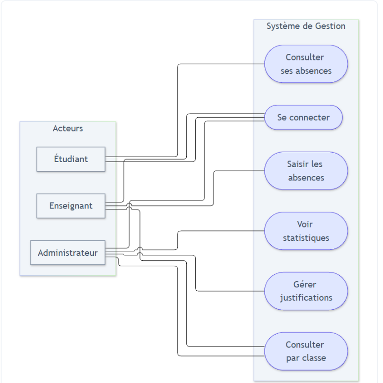
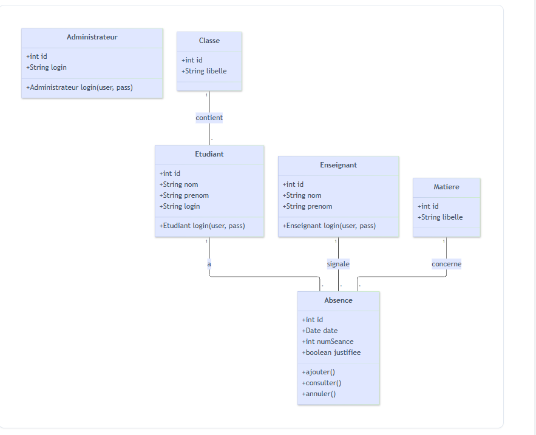
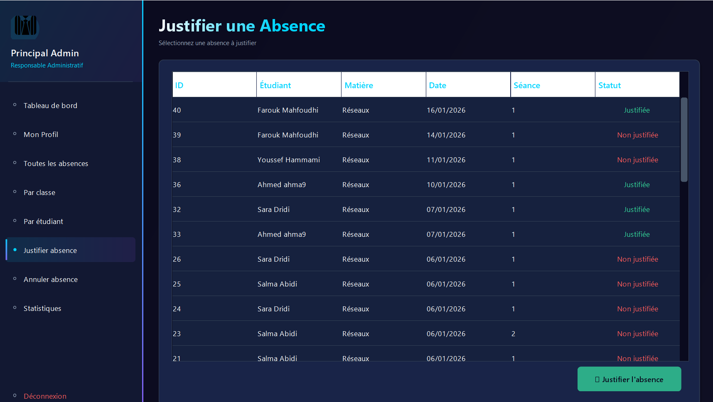
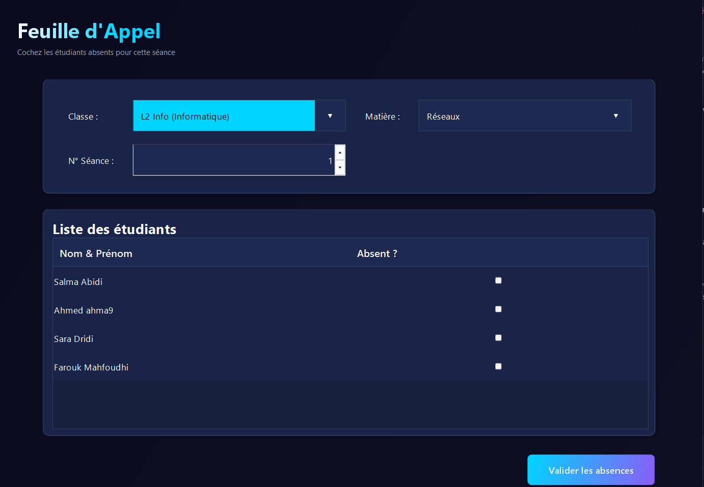

# Gestion des Absences

Application Java de bureau destinée à gérer le cycle complet des absences dans un établissement éducatif.

Elle offre des tableaux de bord adaptés à trois rôles : **Étudiant**, **Enseignant** et **Responsable administratif**. Le projet présente une interface graphique moderne Java Swing, une interface console et une persistance des données via JDBC/MySQL.

## Présentation

Le système permet de centraliser les absences, de consulter l'historique, d'enregistrer ou d'annuler une absence, de gérer les justificatifs et de visualiser les statistiques. Son objectif est de rendre le suivi des absences fiable, rapide et compréhensible pour chaque acteur.

Ce README synthétise les informations détaillées du rapport du projet.

## Fonctionnalités

### Pour tous les utilisateurs

- Authentification multi-rôles
- Interface adaptée au profil connecté
- Gestion de session

### Étudiant

- Consulter ses absences
- Visualiser ses statistiques personnelles
- Consulter le graphique de répartition des absences
- Accéder à son historique

### Enseignant

- Enregistrer une absence
- Sélectionner une classe, une matière et un étudiant
- Consulter les absences concernées
- Visualiser les informations utiles à son activité

### Responsable administratif

- Consulter toutes les absences
- Filtrer les absences par classe ou étudiant
- Justifier ou annuler une absence
- Consulter les statistiques globales
- Gérer les données de référence : étudiants, classes et matières

## Technologies

| Technologie | Utilisation |
|---|---|
| Java 8+ | Logique applicative |
| Java Swing | Interface graphique |
| Java AWT | Composants graphiques |
| JDBC | Accès aux données |
| MySQL | Stockage relationnel |
| MySQL Connector/J 8.0.33 | Pilote JDBC |
| Pattern DAO | Isolation des accès à la base |
| Architecture MVC simplifiée | Séparation présentation, modèle et données |

## Architecture

L'application suit une architecture en couches :

```text
Couche présentation
  LoginFrame, MainFrame, Theme
          |
          v
Couche métier
  Utilisateur, Etudiant, Enseignant, Responsable
  Absence, Classe, Matiere
          |
          v
Couche d'accès aux données
  AuthentificationDAO, AbsenceDAO, EtudiantDAO
  ClasseDAO, MatiereDAO
          |
          v
MySQL via DBConnection et JDBC
```

- `src/gui` : écrans Swing et thème graphique
- `src/main` : application console
- `src/model` : modèles métier
- `src/dao` : opérations JDBC et requêtes préparées
- `src/util` : connexion à MySQL et utilitaires
- `database_schema.sql` : création du schéma et chargement des données de démonstration
- `lib` : pilote MySQL Connector/J

## Modèle fonctionnel

| Diagramme | Description |
|---|---|
|  | Relations entre les trois rôles et les principales fonctionnalités du système |
|  | Principales classes du modèle, leurs attributs et les relations métier |

## Prérequis

- JDK 8 ou supérieur
- Serveur MySQL 8 ou compatible
- MySQL Connector/J fourni dans `lib/mysql-connector-j-8.0.33.jar`
- Windows avec les scripts `.bat` fournis

## Installation

1. Importer le schéma de démonstration :

   ```powershell
   mysql -u root -p < database_schema.sql
   ```

2. Définir les paramètres locaux de connexion :

   ```powershell
   $env:DB_URL="jdbc:mysql://localhost:3306/absence_db"
   $env:DB_USER="root"
   $env:DB_PASSWORD="<mot-de-passe-local>"
   ```

3. Compiler l'application :

   ```powershell
   .\compile.bat
   ```

4. Démarrer l'interface graphique :

   ```powershell
   .\runGUI.bat
   ```

Pour démarrer l'application console :

```powershell
.\run.bat
```

> Les variables d'environnement remplacent toute valeur sensible codée en dur. Aucun secret réel ne doit être ajouté au dépôt.

## Comptes de démonstration

Tous les comptes locaux de démonstration utilisent le mot de passe `demo123`.

| Rôle | Identifiant |
|---|---|
| Responsable | `admin` |
| Enseignant | `enseignant1` |
| Étudiant | `etudiant1` |

Ces données sont uniquement destinées à une démonstration locale. Elles doivent être remplacées ou désactivées avant tout déploiement réel.

## Captures d'écran

| Connexion | Tableau de bord responsable |
|---|---|
|  |  |

| Tableau de bord enseignant | Tableau de bord étudiant |
|---|---|
|  |  |

| Gestion des absences | Enregistrement d'une absence |
|---|---|
|  |  |

## Structure du projet

```text
GestionAbsences/
├── docs/screenshots/
├── lib/
├── src/
│   ├── dao/
│   ├── gui/
│   ├── main/
│   ├── model/
│   └── util/
├── database_schema.sql
├── compile.bat
├── run.bat
└── runGUI.bat
```

## Améliorations possibles

- Application web pour un accès multi-plateforme
- Rapports PDF ou Excel
- Notifications automatiques
- Migration vers Spring Boot
- Export des statistiques
- Authentification basée sur des mots de passe robustes et salés

## Auteur

- Mehdi Braiek
- Farouk Mahfoudhi

**Classe :** GLSI2 GRP3

---

© 2026 — Tous droits réservés
