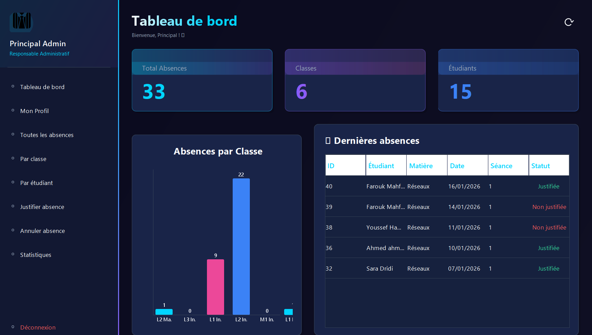
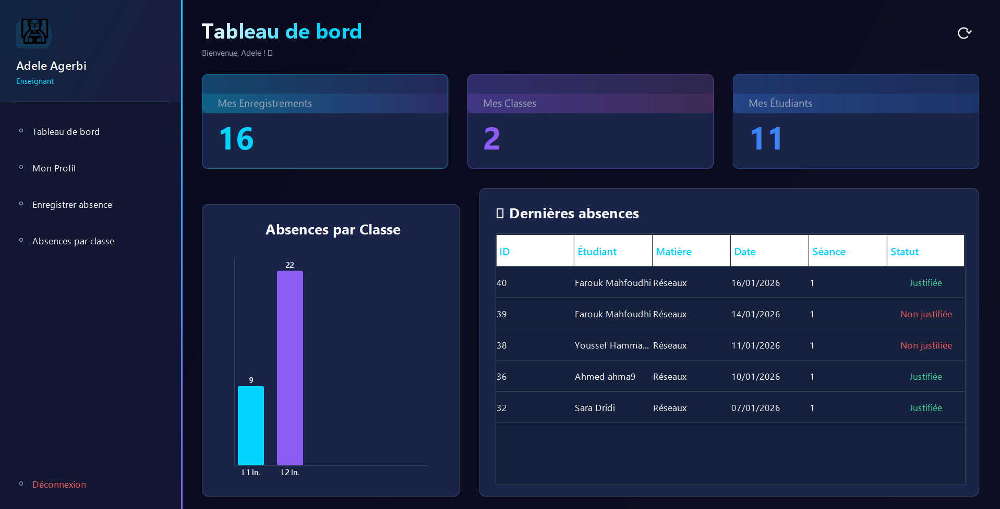
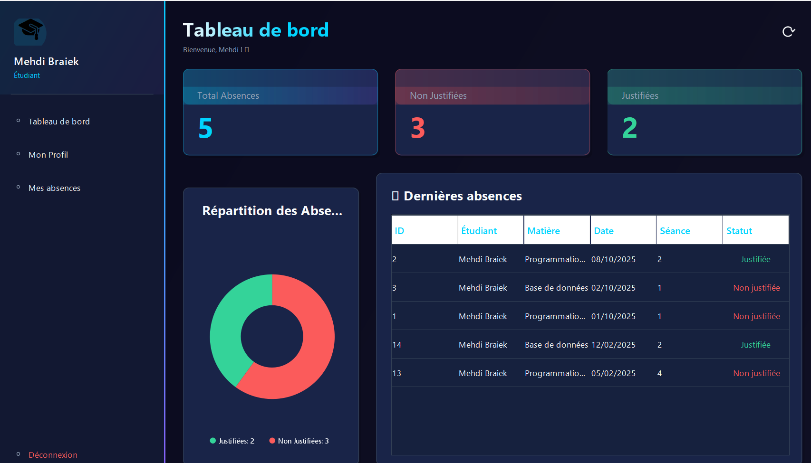

# Gestion des Absences

Application Java de bureau pour gérer les absences des étudiants selon trois profils : étudiant, enseignant et responsable.

## Fonctionnalités

- Authentification des utilisateurs
- Suivi des absences par étudiant, classe, matière et enseignant
- Justification et annulation d'absences
- Statistiques et tableaux de bord
- Interfaces graphique Java Swing et console

## Technologies

- Java
- Java Swing
- JDBC
- MySQL
- mysql-connector-j

## Architecture

Le projet suit une séparation en couches :

- `src/model` : modèles métier
- `src/dao` : accès aux données avec JDBC
- `src/gui` : interface graphique Java Swing
- `src/main` : application console
- `src/util` : connexion MySQL et utilitaires
- `database_schema.sql` : création de la base et données de démonstration

## Prérequis

- JDK 8 ou supérieur
- MySQL 8 ou compatible
- mysql-connector-j placé dans `lib/`

## Installation

1. Créer la base et les données de démonstration :

   ```powershell
   mysql -u root -p < database_schema.sql
   ```

2. Configurer les variables d'environnement MySQL :

   ```powershell
   $env:DB_URL="jdbc:mysql://localhost:3306/absence_db"
   $env:DB_USER="root"
   $env:DB_PASSWORD="<mot-de-passe-local>"
   ```

3. Compiler :

   ```powershell
   .\compile.bat
   ```

4. Lancer l'interface graphique :

   ```powershell
   .\runGUI.bat
   ```

Pour l'application console :

```powershell
.\run.bat
```

## Comptes de démonstration

Tous les comptes de démonstration utilisent le mot de passe `demo123`.

| Rôle | Identifiant |
|---|---|
| Responsable | `admin` |
| Enseignant | `enseignant1` |
| Étudiant | `etudiant1` |

Ces comptes sont réservés aux environnements locaux de démonstration. Remplacez-les ou désactivez-les avant tout déploiement.

## Captures d'écran

| Connexion | Tableau de bord responsable |
|---|---|
|  |  |

| Tableau de bord enseignant | Tableau de bord étudiant |
|---|---|
|  |  |

| Gestion des absences | Enregistrer une absence |
|---|---|
|  |  |
